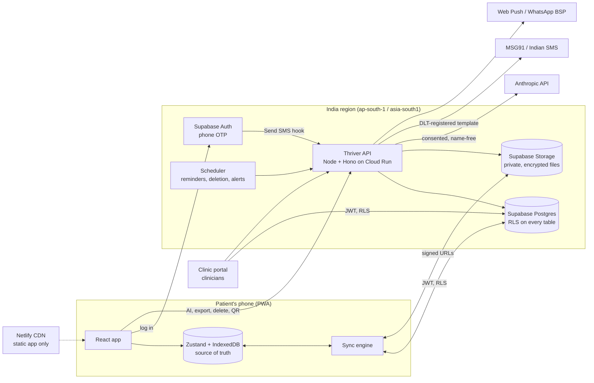
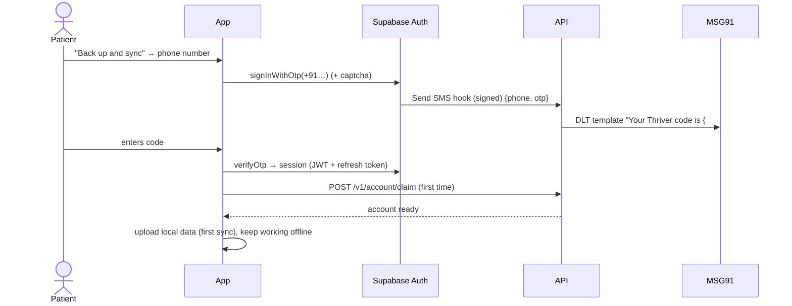
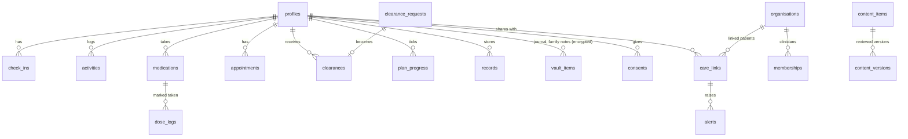
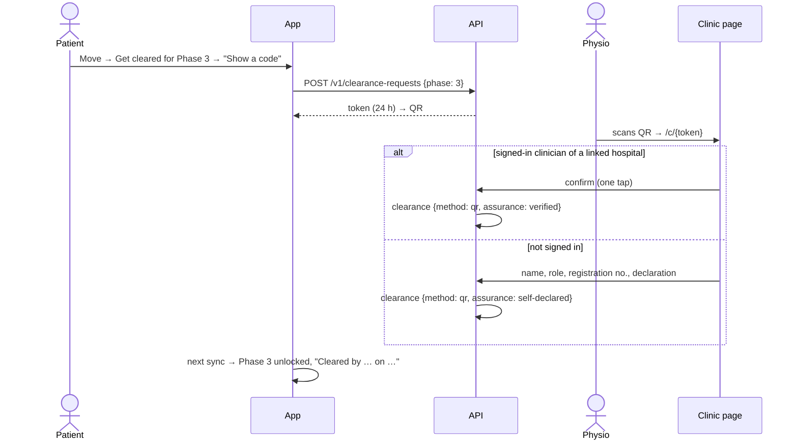

# Thriver backend architecture

Status: **proposal** (October 2026). Builds on the log-in plan in
[research 06](../research/06-accounts-and-login.md) and the regulatory notes in
[research 04](../research/04-mvp-and-regulation.md). Not legal advice; vendor features change, so
check them before committing.

## 1. What the backend is for

Today Thriver runs entirely on the phone. Everything is in localStorage and IndexedDB, and the only
server code is the two AI endpoints in `server/`, served by the Vite dev server. A backend is needed
for six things:

| Need                                  | Why                                                                                                  |
| ------------------------------------- | ---------------------------------------------------------------------------------------------------- |
| **Accounts** (phone OTP)              | Lost or changed phones currently lose everything                                                     |
| **Backup and sync** across devices    | Includes records files, which are the most valuable data                                             |
| **AI endpoints in production**        | Today they only run under `vite dev/preview`; they need auth, rate limits and a real host            |
| **Care-team links** (hospital pilots) | Clearances by QR or hospital code, warning-sign alerts, a simple hospital dashboard                  |
| **Reminders**                         | Medication and appointment reminders by push (later WhatsApp)                                        |
| **Reviewed content**                  | Guides, phases, plans and warning-sign rules updated after clinical sign-off, without an app release |

## 2. Principles

1. **Local-first.** The phone stays the source of truth and works offline. The server is backup,
   sync and sharing, never a requirement to open the app. "Use without an account" remains.
2. **Health data stays in India where we control it.** Database, files and API in Mumbai. The one
   exception is the AI provider (see §8), which the person consents to separately.
3. **Least access by default.** Every table is deny-by-default with row-level security. Clinicians
   see only what a patient has shared with their hospital, and never journals or family notes.
4. **Managed services over custom infrastructure.** A small team can't run databases and auth
   safely; buy them.
5. **One language.** TypeScript end to end, reusing the existing Zod schemas and `server/` handlers.

## 3. The shape of it



### Choices

| Part                  | Choice                                                                              | Why / alternatives                                                                                                                                                                                                                                                                                                  |
| --------------------- | ----------------------------------------------------------------------------------- | ------------------------------------------------------------------------------------------------------------------------------------------------------------------------------------------------------------------------------------------------------------------------------------------------------------------- |
| Database, auth, files | **Supabase**, project in **South Asia (Mumbai), `ap-south-1`**                      | Postgres (relational data for hospital dashboards), row-level security, phone OTP and private storage in one service, open source (can self-host later). Supabase lists Mumbai as a region. Firebase is the alternative (mature phone auth, Mumbai region) but its NoSQL rules make sharing with clinicians harder. |
| API                   | **Node + [Hono](https://hono.dev)** on **Google Cloud Run, `asia-south1` (Mumbai)** | Reuses `server/recordsAssistant.ts` and `server/aiPicks.ts` as they are. Scales to zero, pinned to Mumbai, container-based so it can move to AWS `ap-south-1` later. Supabase Edge Functions would also work; a plain Node container is easier to test locally and to move between clouds.                          |
| Static app            | **Netlify** (as planned)                                                            | Serves only HTML/JS/CSS, never health data.                                                                                                                                                                                                                                                                         |
| OTP SMS               | Supabase **Send SMS hook** → our API → **MSG91** (or another Indian provider)       | The hook lets Supabase use a regional SMS provider. Indian SMS needs **TRAI DLT registration** (entity, sender ID and OTP template) before launch; allow a week or two.                                                                                                                                             |
| Reminders             | **Web Push** first, **WhatsApp Business** templates later                           | Push is free. On iPhone it works only when the app is added to the home screen. WhatsApp reaches older users but needs a business provider and approved templates.                                                                                                                                                  |
| Monitoring            | **Sentry** (with health data scrubbed), Cloud Run logs, uptime checks               | Logs must never contain health data or AI conversations.                                                                                                                                                                                                                                                            |

## 4. Accounts and identity



- **Roles** live in the JWT as a custom claim (`patient`, `clinician`, `org_admin`, `content_editor`).
  Patients are the default.
- **Clinicians** sign in by email magic link to the clinic portal after an invitation from their
  hospital's admin. Thriver staff check their registration number by hand at onboarding.
- **Guests:** the app keeps working without an account. AI endpoints for guests get a signed device
  token with tighter rate limits, so they can't be abused anonymously.
- **Security:** short-lived access tokens, rotating refresh tokens, "log out on all devices",
  captcha and per-number limits on OTP requests, and an optional app lock (device PIN or biometrics)
  because phones are often shared in families.

## 5. Data model

Every synced table shares the same columns: `id uuid` (created on the phone, so it works offline),
`user_id`, `client_updated_at`, `updated_at` (set by the server), `deleted_at` (soft delete, so
deletions sync).



| Table                         | From today's store                      | Who can read                                                |
| ----------------------------- | --------------------------------------- | ----------------------------------------------------------- |
| `profiles`                    | `thriver-profile` (health, care team)   | Patient; linked hospital (if shared)                        |
| `check_ins`                   | `thriver-recovery` check-ins + mood     | Patient; linked hospital (if shared)                        |
| `clearances`, `plan_progress` | `thriver-recovery`                      | Patient; linked hospital                                    |
| `activities`                  | `thriver-move`                          | Patient; linked hospital (if shared)                        |
| `medications`, `dose_logs`    | `thriver-medication`                    | Patient; linked hospital (if shared)                        |
| `appointments`                | `thriver-appointments`                  | Patient only                                                |
| `records` + Storage file      | `thriver-records` + IndexedDB files     | Patient only (sharing a record is a later, explicit action) |
| `vault_items`                 | journal, family notes, saved guides     | **Patient only, always encrypted**                          |
| `consents`                    | assistant / AI-picks consent            | Patient; append-only history                                |
| `care_links`, `alerts`        | new                                     | Patient and the linked hospital                             |
| `content_items`               | `guides.ts`, `phases.ts`, rules, quotes | Everyone (approved versions only)                           |
| `audit_log`                   | new                                     | Thriver compliance only                                     |

A draft of the core tables and policies:

```sql
create table profiles (
  user_id uuid primary key references auth.users on delete cascade,
  name text check (char_length(name) <= 30),
  cancer_type text,
  surgery_date date,
  treatments text[] not null default '{}',
  conditions text[] not null default '{}',
  care_team jsonb not null default '{}',      -- {name, phone}
  client_updated_at timestamptz not null,
  updated_at timestamptz not null default now()
);

create table check_ins (
  id uuid primary key,
  user_id uuid not null references auth.users on delete cascade,
  day date not null,
  tiredness smallint check (tiredness between 0 and 10),
  pain smallint check (pain between 0 and 10),
  warnings text[] not null default '{}',
  mood text,
  client_updated_at timestamptz not null,
  updated_at timestamptz not null default now(),
  deleted_at timestamptz,
  unique (user_id, day)
);

create table care_links (
  id uuid primary key default gen_random_uuid(),
  user_id uuid not null references auth.users on delete cascade,
  org_id uuid not null references organisations,
  scopes text[] not null,                     -- e.g. {'summary','check_ins','alerts'}
  created_at timestamptz not null default now(),
  revoked_at timestamptz
);

alter table check_ins enable row level security;

create policy "patients manage their own check-ins" on check_ins
  for all using (user_id = auth.uid()) with check (user_id = auth.uid());

create policy "linked clinicians read shared check-ins" on check_ins
  for select using (exists (
    select 1 from care_links l join memberships m on m.org_id = l.org_id
    where l.user_id = check_ins.user_id and l.revoked_at is null
      and 'check_ins' = any(l.scopes) and m.user_id = auth.uid()
  ));
```

RLS policies get their own automated tests (pgTAP in `supabase/tests/`) so that a clinician from
another hospital, or another patient, provably can't read a row.

## 6. Sync

The phone keeps its Zustand stores. A new `src/features/sync` engine maps store entries to rows and
back. No conflict-free data types (CRDTs) are needed: one person edits their own data on a few
devices.

- **Push:** changed rows are upserted by `id`. A database trigger keeps whichever edit has the later
  `client_updated_at` (last write wins per row), and soft deletes win over edits.
- **Pull:** for each table, fetch rows with `updated_at > cursor`, merge them into the store, and
  save the new cursor. This runs on app start, on reconnect, and every few minutes while the app is
  open.
- **First sync:** local data is uploaded. If the account already has data (a new phone), the two are
  merged by `id`, and the person sees "Restored from your backup".
- **Records files** upload in the background through a resumable upload to
  `records/{user_id}/{record_id}` and download on demand. The phone keeps them cached for offline use.
- **Day-keyed stores** (check-ins, mood, plan ticks) map to `unique (user_id, day)` rows.

## 7. Encryption

| Data                                 | Protection                                                                                                                                                                                                                     |
| ------------------------------------ | ------------------------------------------------------------------------------------------------------------------------------------------------------------------------------------------------------------------------------ |
| Everything                           | TLS in transit; AES-256 disk encryption at rest (provider)                                                                                                                                                                     |
| Records files, journal, family notes | **Also encrypted on the phone** (AES-GCM, Web Crypto) with a per-user **vault key** before upload. A stolen bucket or database dump is unreadable.                                                                             |
| The vault key                        | **Recommended for launch: server-assisted.** The key is wrapped by a cloud KMS key; after log-in, the API unwraps it for that user only, and every unwrap is audited. Losing the phone doesn't lose data.                      |
| Later option                         | **True end-to-end:** the key is wrapped by a recovery code the person writes down. The server can never read it, but losing the code means losing the data. Offer this as "extra privacy", not the default, given older users. |

Fields clinicians may see (profile, check-ins, activity, doses, clearances) are stored readable,
protected by RLS and audited, because hospitals need them for dashboards and alerts.

## 8. API (Thriver API service)

All routes are versioned, JSON, validated with Zod, and require a Supabase JWT (or a guest device
token where noted).

| Route                                  | Purpose                                                                                                                         |
| -------------------------------------- | ------------------------------------------------------------------------------------------------------------------------------- |
| `POST /v1/ai/records-assistant`        | Today's `runAssistantTurn`. Checks the `consents` row server-side. Rate limited (e.g. 30 questions a day). Guest token allowed. |
| `POST /v1/ai/picks`                    | Today's `runAiPicks`. Same checks, cached per profile.                                                                          |
| `POST /v1/vault/key`                   | Returns the unwrapped vault key for the signed-in user (audited).                                                               |
| `POST /v1/account/export`              | Builds a zip (JSON, plus decrypted files) and returns a short-lived download link.                                              |
| `DELETE /v1/account`                   | Locks the account at once and hard-deletes after a 7-day undo window (rows, files, vault key).                                  |
| `POST /v1/care-links` / `DELETE …/:id` | Patient links to a hospital using its code, choosing what to share. Revoking takes effect immediately.                          |
| `POST /v1/clearance-requests`          | Creates a one-time token (24 h) for the "Show a code to your physio" QR.                                                        |
| `GET/POST /v1/clearance/:token`        | Clinician side of the QR (see below).                                                                                           |
| `POST /v1/push/subscribe`              | Stores a Web Push subscription.                                                                                                 |
| `POST /internal/sms-hook`              | Supabase Send SMS hook (signature verified) → MSG91.                                                                            |
| `POST /internal/jobs/:name`            | Called by Cloud Scheduler: due reminders, deletions, alert delivery.                                                            |

**AI and data leaving India.** AI requests go from the Mumbai API to Anthropic, outside India.
Thriver should:

- send only what each feature needs (already true: no name, records only when opened);
- keep the separate, logged consent the app already asks for;
- log metadata only (model, tokens, latency), never conversation content;
- sign a data processing agreement with Anthropic covering health data and retention.

Under the DPDP Act, cross-border transfers follow a "negative list" (Section 16). Secondary
sources say Section 16 hadn't commenced as of September 2026, and that no countries were
restricted as of mid-2026. Confirm both with a lawyer before launch.

## 9. Care teams and hospitals



- **Hospital code:** each organisation gets a code. Entering it creates a `care_link`, and the
  patient chooses what to share: summary, check-ins and alerts.
- **Warning-sign alerts:** when a shared check-in reports a warning sign, a database trigger writes
  to an outbox. A job then shows it on the hospital dashboard and notifies the on-duty contact
  during working hours. The patient still sees 112/108 immediately. The app must be clear that
  hospital alerts are not an emergency service.
- **Clinic portal** (phase 3): a separate small web app in the same repo (`apps/clinic`) with the
  patient list, recovery summaries (the same `buildSummary` logic), adherence, open alerts and
  clearances. Read-only apart from clearances and acknowledging alerts.

## 10. Reviewed content

Guides, phases and plans, warning-sign rules, meditations and daily lines move from TypeScript files
to `content_items`, with versions and a workflow: `draft → in review → approved`. Each version
records the reviewer's name, role and date, so the app can show "Reviewed by …" in place of
"Pending clinical review". The app ships with the approved snapshot from build time and fetches
newer approved versions (cached with ETags), so it still works offline. Editors start in Supabase
Studio, and a small admin page comes later.

## 11. Privacy and compliance features

- **Consents:** append-only `consents` rows with purpose, version of the wording, and given or
  withdrawn timestamps. The API checks them; withdrawal takes effect on the next request.
- **Audit log:** reads of patient data by anyone other than the patient (clinicians, staff), vault
  key unwraps, exports and deletions.
- **Export and delete** reuse the privacy centre UI, now also covering server copies. Backups
  (point-in-time recovery) age out deleted data within the retention window, which the privacy
  notice states.
- **Breach response:** alerting on unusual access patterns; a runbook for the notification steps the
  DPDP Rules require.
- **Data minimisation:** analytics are event counts only, with no health values, and opt-in.

## 12. Repository layout

```
api/                  Thriver API (Hono). Imports the handlers in server/; Dockerfile for Cloud Run
server/               (existing) AI handlers, unchanged; the Vite plugin stays for local dev
supabase/
  migrations/         SQL migrations (tables, RLS, triggers)
  tests/              pgTAP tests for every RLS policy
  seed.sql            local test data
src/features/account/ Log-in screen ("Back up and sync"), account settings
src/features/sync/    Sync engine (store ⇄ table mappers, cursors, file upload queue)
apps/clinic/          Clinic portal (phase 3)
```

New env vars (added to `src/shared/config/env.ts` and `.env.example`): `VITE_SUPABASE_URL`,
`VITE_SUPABASE_ANON_KEY`, `VITE_API_URL`. The API's secrets (`ANTHROPIC_API_KEY`, Supabase service
key, MSG91 key, KMS key name, VAPID keys) live in Google Secret Manager, never in the app.

**Environments:** local (`supabase start` in Docker plus `pnpm dev`), staging and production, each
with its own Supabase project and Cloud Run service. CI applies migrations to a throwaway database
and runs the RLS tests, unit tests and e2e tests before deploying.

## 13. Phases

| Phase                      | Delivers                                                                                                                                               | Depends on                                  |
| -------------------------- | ------------------------------------------------------------------------------------------------------------------------------------------------------ | ------------------------------------------- |
| **0. Foundations**         | Supabase project (Mumbai), migrations and RLS tests, API on Cloud Run with the two AI routes behind guest tokens and rate limits; Netlify deploy       | Company accounts; Anthropic data agreement  |
| **1. Accounts and backup** | Phone OTP (DLT registered), "Back up and sync", sync for profile, recovery, medication, appointments and move; consents server-side; export and delete | DLT approval                                |
| **2. Records and vault**   | Encrypted records files and journal backup, restore on a new phone, Web Push reminders                                                                 | KMS setup                                   |
| **3. Hospital pilot**      | Organisations, hospital codes, care links, QR clearance, alerts outbox, clinic portal, reviewed content CMS                                            | Pilot hospital agreement; clinical sign-off |
| **4. Later**               | WhatsApp reminders, ABHA/ABDM records import, optional end-to-end vault, community                                                                     | ABDM sandbox approval                       |

## 14. Decisions to make

1. **Supabase or Firebase.** Recommended: Supabase (SQL and row-level security suit hospital sharing).
2. **Vault key: server-assisted or end-to-end by default.** Recommended: server-assisted at launch,
   with end-to-end as an option.
3. **Self-declared clinician clearances by QR.** Allow them, marked "self-declared", or require a
   signed-in clinician from a linked hospital? Recommended: allow them in the pilot, and show the
   assurance level on the summary.
4. **API host.** Google Cloud Run in Mumbai (recommended) or AWS `ap-south-1`.

## Sources

- [Supabase regions](https://supabase.com/docs/guides/platform/regions) (South Asia, Mumbai, `ap-south-1`)
- [Supabase Send SMS hook](https://supabase.com/docs/guides/auth/auth-hooks/send-sms-hook.md) (use a regional SMS provider)
- [DLT registration for SMS in India](https://www.plivo.com/docs/sms/concepts/dlt-registration-process) and
  [step-by-step guide](https://www.enablex.io/insights/a-step-by-step-guide-to-dlt-registration/)
- DPDP cross-border transfers: [Mondaq](https://www.mondaq.com/india/data-protection/1764976/from-localisation-debates-to-a-negative-list-making-cross-border-data-transfers-work-under-indias-dpdp-act),
  [KS&K](https://ksandk.com/data-protection-and-data-privacy/cross-border-data-transfers-dpdp-act-india/)
